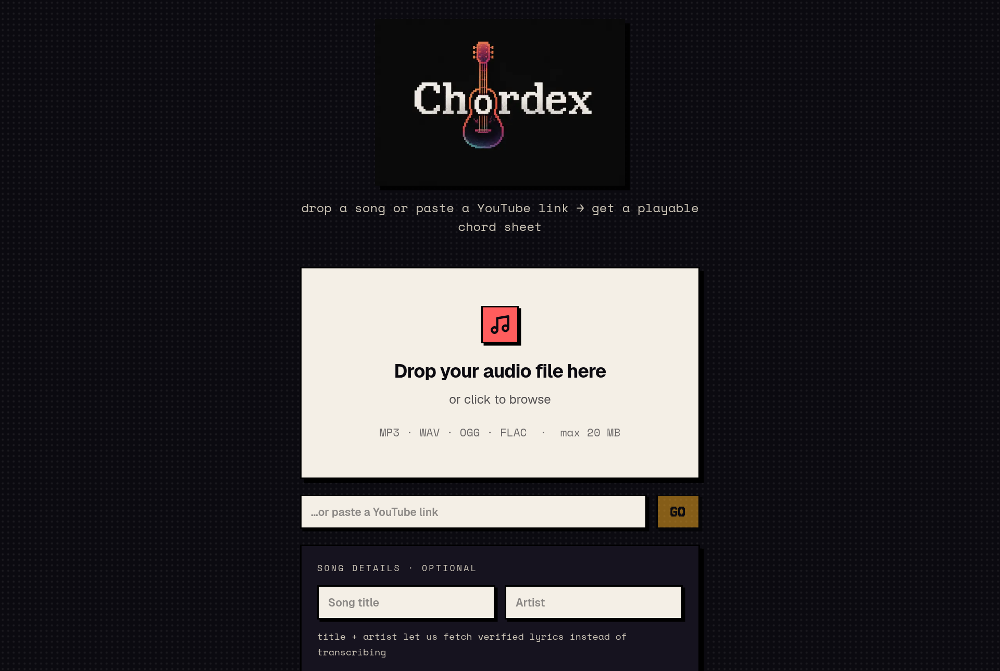
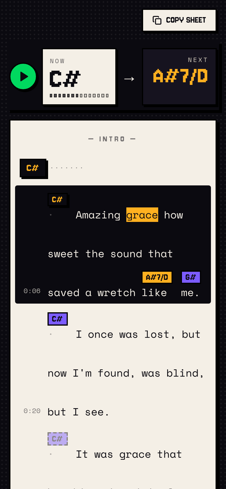

<div align="center">


### Drop a song or paste a YouTube link. Get a playable chord sheet.

Chords **and** lyrics, with every chord sitting on the exact syllable where it
changes. Transpose, Easy Mode (capo + open shapes), and Hindi / Malayalam
lyrics in easy-to-read English letters.

[](https://github.com/anandude/chordex/actions/workflows/ci.yml)
[](LICENSE)
[](CONTRIBUTING.md)


</div>

## Features

- **Chords on the syllable.** Lyrics are force-aligned to the audio, and each
  chord change is anchored to the word, or syllable, where it lands, like a
  hand-made chord sheet. Copy it out as ChordPro.
- **Any song in, any key out.** Upload MP3/WAV/OGG/FLAC or paste a YouTube
  link. Transpose ±11 semitones, or turn on **Easy Mode** for a capo position
  and beginner-friendly open shapes.
- **Indian languages first.** Tuned speech models for **Hindi** and
  **Malayalam** (English works too). Lyrics can be shown in the original script
  or in everyday English letters, the way people actually type them:

  | Original | Chordex shows |
  |---|---|
  | दिल की धड़कन | dil ki dhadkan |
  | मैं तुम्हें समझता हूँ | main tumhein samajhta hun |
  | നിന്റെ കണ്ണുകളിൽ | ninte kannukalil |
  | ഞാൻ കണ്ടു | njaan kandu |

- **Verified lyrics when available.** Synced lyrics from
  [LRCLIB](https://lrclib.net) are used when the song is found. Otherwise
  vocals are separated and transcribed.
- **Play along.** Chord-coloured scrubber, live NOW/NEXT chord, the sung line
  highlighted as it plays, and Space to play or pause.
- **Your songs.** Every transcription is listed on the upload page, so you can
  reopen one later and transpose it again. History is tied to a random id in
  this browser, not an account: nobody else can see your songs, and there is no
  sign-up. Saved songs keep the sheet but not the audio.
- **Runs on your machine.** A 4 GB GPU (tested on a GTX 1650) makes it fast,
  but everything also runs on CPU.

<details>
<summary>More screenshots</summary>

| Home | Mobile |
|---|---|
|  |  |

</details>

## How it works

```
upload / YouTube link
        │
        ├─► chord job (seconds) ── Chordino (NNLS-chroma) or template-HMM
        │                          + beat grid, key, tempo
        │
        └─► lyrics job (≈1 min on GPU)
              LRCLIB lookup ──hit──► synced lines
                   │ miss
              Demucs vocal separation
              language ID (hi / ml / en)
              ASR: faster-whisper (Hindi/English fine-tunes)
                   Indic-Transcribe-core (Malayalam)
              MMS forced alignment → word & syllable timings
                   │
                   ▼
   sheet builder (backend/pipeline/sheet.py): chords anchored to syllables
                   │
                   ▼
   Next.js UI: transpose / Easy Mode / English letters, all client-side
```

Chords show up within seconds while lyrics are still processing. The two run
on separate Redis/RQ queues.

## Quick start

**You need:** Linux or macOS, Python 3.11, Node.js 20+, Docker (only to run
Redis; a local `redis-server` works too), plus `ffmpeg` and `libsndfile`.

```bash
# Ubuntu/Debian system packages
sudo apt-get install -y ffmpeg libsndfile1

git clone https://github.com/anandude/chordex.git
cd chordex
./start.sh
```

The first run creates `backend/.venv`, installs everything and starts Redis,
the API, both workers and the frontend. Open **http://localhost:3000**.

| Command | |
|---|---|
| `./start.sh` | Start everything (installs on first run) |
| `./start.sh --stop` | Stop everything |
| `./start.sh --setup` | Reinstall dependencies, then start |
| `./start.sh --prewarm` | Pre-download the speech models |
| `./start.sh --docker` | API + worker + Redis in Docker Compose (CPU) |

Logs are in `.run/logs/` (`worker-lyrics.log` for lyrics).

### Malayalam (one-time)

The default Malayalam model, [`bodhan-ai/indic-transcribe-core`](https://huggingface.co/bodhan-ai/indic-transcribe-core),
is gated. Accept its terms on Hugging Face, then log in once:

```bash
backend/.venv/bin/hf auth login
```

Without this, Malayalam quietly falls back to an older Whisper fine-tune.

### GPU

GPU use is automatic (`WHISPER_DEVICE=auto`, `LYRICS_DEVICE=auto`). Defaults
are tuned for a 4 GB card: int8 Whisper, with one model on the GPU at a time.
With no GPU, everything runs on CPU, and lyrics take a few minutes instead of
about one.

### Configuration

Every option is documented in [`backend/.env.example`](backend/.env.example).
Copy it to `backend/.env` to change anything. The ones you're most likely to
touch:

| Variable | Default | |
|---|---|---|
| `ENABLE_LYRICS` | `1` | `0` = chords only |
| `LYRICS_LRCLIB` | `1` | Look up verified lyrics before transcribing |
| `LYRICS_ROMAN_BACKEND` | `readable` | English-letter spelling engine |
| `MAX_FILE_SIZE_MB` | `20` | Upload limit |
| `YOUTUBE_MAX_DURATION_S` | `1200` | Longest YouTube video accepted |
| `DATABASE_URL` | *(unset)* | Postgres for song history; unset = history off |
| `NEXT_PUBLIC_API_URL` (frontend) | `http://localhost:8000` | Where the UI finds the API |

## API

| | |
|---|---|
| `POST /api/analyze` | multipart `file` (+ optional `language`, `title`, `artist`) → `{job_id}` |
| `POST /api/analyze-url` | JSON `{url, language?, title?, artist?}` (YouTube) → `{job_id}` |
| `GET /api/status/{job_id}` | Chords as soon as they're ready; `result.sheet` once lyrics land |
| `GET /api/audio/{job_id}` | The audio, with Range support, for playback |
| `DELETE /api/jobs/{job_id}` | Cancel |
| `GET /api/library` | This device's saved songs (metadata only) |
| `GET /api/library/{job_id}` | One saved song, including its full result |
| `DELETE /api/library/{job_id}` | Forget one saved song |
| `GET /health` | Config + Redis check |

The library endpoints take the owner as an `X-Device-Id` header (or a
`?device_id=` query parameter) — the random id the browser keeps in
`localStorage`. Every read is scoped to it, so one visitor can never see
another's songs. Set `DATABASE_URL` (see below) to turn the library on; without
it the endpoints report `{"enabled": false}` and nothing else changes.

## Pages

The Next.js app lives at the repository root (it moved out of `frontend/`).

| Route | |
|---|---|
| `/` | Landing page |
| `/upload` | Drop a file, paste a YouTube link, pick a language |
| `/results/<job_id>` | Playback controls + the chord sheet |

The site is deployed as a static export, so every `/results/<id>` is served by
one exported page: `public/_redirects` rewrites the path and
[`lib/staticJob.ts`](lib/staticJob.ts) reads the real id from the URL.

## Deployment

The live site is a static frontend (Cloudflare Pages, or Vercel) talking to a
CPU backend on an InstaBox machine. See
[`deploy/instabox/README.md`](deploy/instabox/README.md) for the Docker Compose
stack, the build commands and the environment variables.

## Development

```bash
cd backend && .venv/bin/python -m pytest -q    # backend tests
npm run lint && npx tsc --noEmit               # frontend checks (repo root)
```

`eval/` holds the benchmark harness. `eval/run_eval.py` measures timing and,
when reference files exist, lyrics accuracy and chord placement (see
[`eval/refs/REFERENCES.md`](eval/refs/REFERENCES.md)). Design notes live in
[`docs/`](docs).

## Contributing

Contributions are very welcome, especially chord or lyrics accuracy reports,
spelling fixes for the English-letter view, and support for more languages.
Read [CONTRIBUTING.md](CONTRIBUTING.md) to get started, and please follow the
[code of conduct](CODE_OF_CONDUCT.md).

## Limitations

- Automatic chord recognition is never perfect. Expect playable
  progressions on clear pop, film and acoustic songs, and trust your ear on
  dense mixes.
- Machine-transcribed lyrics can be wrong, especially on music videos with
  dialogue or intros. Audio-only uploads work best.
- Only Hindi and Malayalam have tuned models and spelling rules. Other Indic
  scripts get generic transliteration.

## License and responsible use

Chordex's code is [MIT-licensed](LICENSE). It uses third-party models and
libraries with **their own licenses**, including non-commercial model weights
(MMS forced alignment) and an AGPL-3.0 library (aksharamukha). See
[THIRD_PARTY_NOTICES.md](THIRD_PARTY_NOTICES.md) before any commercial or
hosted use.

Songs and lyrics are copyrighted. Use Chordex with music you have the right
to use, and respect YouTube's Terms of Service when using YouTube links.
Never commit audio to this repository.

## Acknowledgements

[Chordino / NNLS-chroma](http://www.isophonics.net/nnls-chroma),
[Demucs](https://github.com/facebookresearch/demucs),
[faster-whisper](https://github.com/SYSTRAN/faster-whisper),
[adalat-ai](https://huggingface.co/adalat-ai) Indic Whisper fine-tunes,
[Bodhan AI / AI4Bharat](https://huggingface.co/bodhan-ai) Indic-Transcribe,
[Meta MMS](https://github.com/facebookresearch/fairseq/tree/main/examples/mms),
[LRCLIB](https://lrclib.net), [Aksharamukha](https://github.com/virtualvinodh/aksharamukha),
and [yt-dlp](https://github.com/yt-dlp/yt-dlp).
