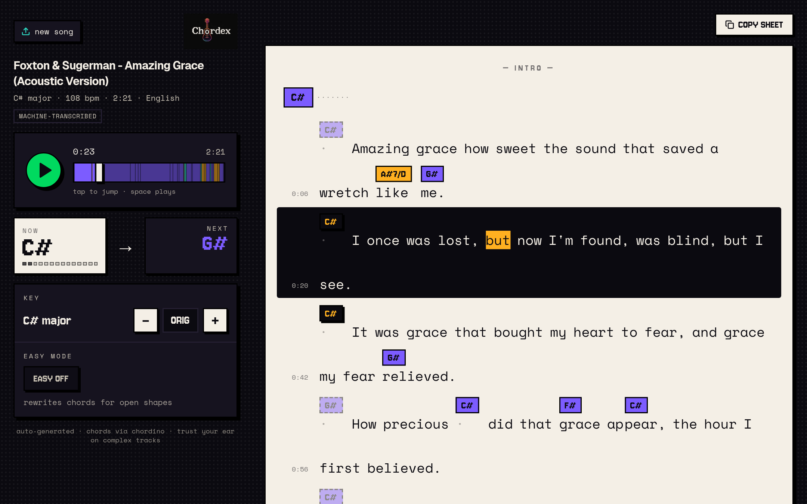

<div align="center">


### Drop a song or paste a YouTube link. Get a playable chord sheet.

Chords **and** lyrics, with every chord sitting on the exact syllable where it
changes. Transpose, Easy Mode (capo + open shapes), and Hindi / Malayalam
lyrics in easy-to-read English letters.

[](https://github.com/anandude/chordex/actions/workflows/ci.yml)
[](LICENSE)
[](CONTRIBUTING.md)



</div>

## Features

- **Chords on the syllable.** Lyrics are force-aligned to the audio, and each
  chord change is anchored to the word, or syllable, where it lands, like a
  hand-made chord sheet. Copy it out as ChordPro.
- **Any song in, any key out.** Upload MP3/WAV/OGG/FLAC or paste a YouTube
  link. Transpose ±11 semitones, or turn on **Easy Mode** for a capo position
  and beginner-friendly open shapes.
- **Indian languages first.** Tuned speech models for **Hindi** and
  **Malayalam** (English works too). Lyrics can be shown in the original script
  or in everyday English letters, the way people actually type them:

  | Original | Chordex shows |
  |---|---|
  | दिल की धड़कन | dil ki dhadkan |
  | मैं तुम्हें समझता हूँ | main tumhein samajhta hun |
  | നിന്റെ കണ്ണുകളിൽ | ninte kannukalil |
  | ഞാൻ കണ്ടു | njaan kandu |

- **Verified lyrics when available.** Synced lyrics from
  [LRCLIB](https://lrclib.net) are used when the song is found. Otherwise
  vocals are separated and transcribed.
- **Play along.** Chord-coloured scrubber, live NOW/NEXT chord, the sung line
  highlighted as it plays, and Space to play or pause.
- **Runs on your machine.** A 4 GB GPU (tested on a GTX 1650) makes it fast,
  but everything also runs on CPU.

## Quick start

```bash
./start.sh --setup     # first run: installs deps, starts Redis + API + workers + UI
```

Then open **http://localhost:3000**. Stop with `Ctrl+C` or `./start.sh --stop`.

Manual setup, piece by piece:

```bash
# Backend (Python 3.11, ffmpeg required)
cd backend
python3 -m venv .venv && source .venv/bin/activate
bash install_deps.sh
uvicorn main:app --port 8000

# Frontend (Node 18+)
npm install
npm run dev            # http://localhost:3000
```

## How it works

```
audio ──► vocal separation (demucs) ──► chord detection (Chordino / MIR)
                                      └► transcription (Whisper) ──► force-alignment
heet built client-side: chords referenced by index, so transpose and
Easy Mode relabel instantly without re-analysing.
```

## Configuration

| Variable | Default | Purpose |
|---|---|---|
| `LYRICS_ROMAN_BACKEND` | `readable` | English-letter spelling engine |
| `MAX_FILE_SIZE_MB` | `20` | Upload limit |
| `YOUTUBE_MAX_DURATION_S` | `1200` | Longest YouTube video accepted |
| `NEXT_PUBLIC_API_URL` (frontend) | `http://localhost:8000` | Where the UI finds the API |

## API

| | |
|---|---|
| `POST /api/analyze` | multipart `file` (+ optional `language`, `title`, `artist`) → `{job_id}` |
| `POST /api/analyze-url` | JSON `{url, language?, title?, artist?}` (YouTube) → `{job_id}` |
| `GET /api/status/{job_id}` | Chords as soon as they're ready; `result.sheet` once lyrics land |
| `GET /api/audio/{job_id}` | The audio, with Range support, for playback |

## Contributing

Contributions are welcome — bug reports, tuned language models, spelling fixes
for the English-letter view, and support for more languages.
Read [CONTRIBUTING.md](CONTRIBUTING.md) to get started, and please follow the
[code of conduct](CODE_OF_CONDUCT.md).

## Limitations

- Automatic chord recognition is never perfect. Expect playable
  progressions on clear pop, film and acoustic songs, and trust your ear on
  dense mixes.
- Machine-transcribed lyrics can be wrong, especially on music videos with
  dialogue or intros. Audio-only uploads work best.
- Only Hindi and Malayalam have tuned models and spelling rules. Other Indic
  scripts get generic transliteration.

## License

[MIT](LICENSE). Third-party notices are in [THIRD_PARTY_NOTICES.md](THIRD_PARTY_NOTICES.md).
